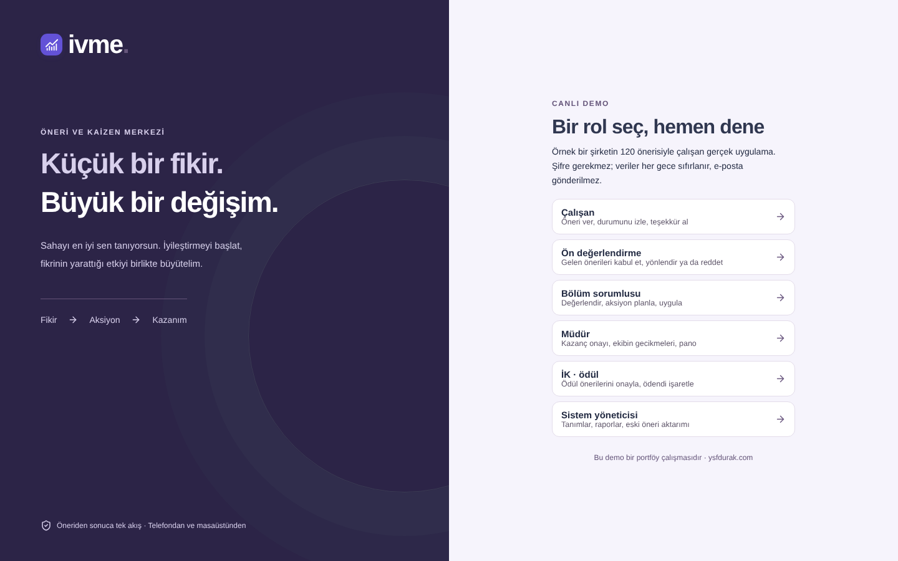
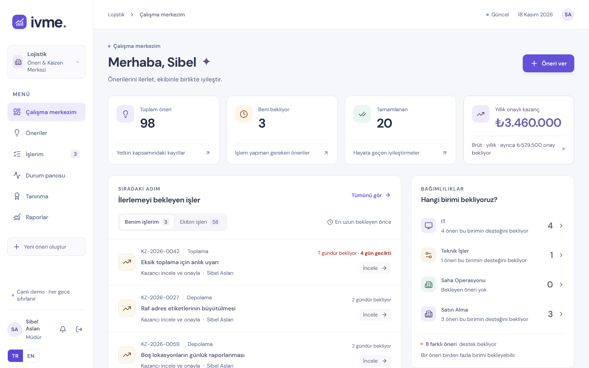
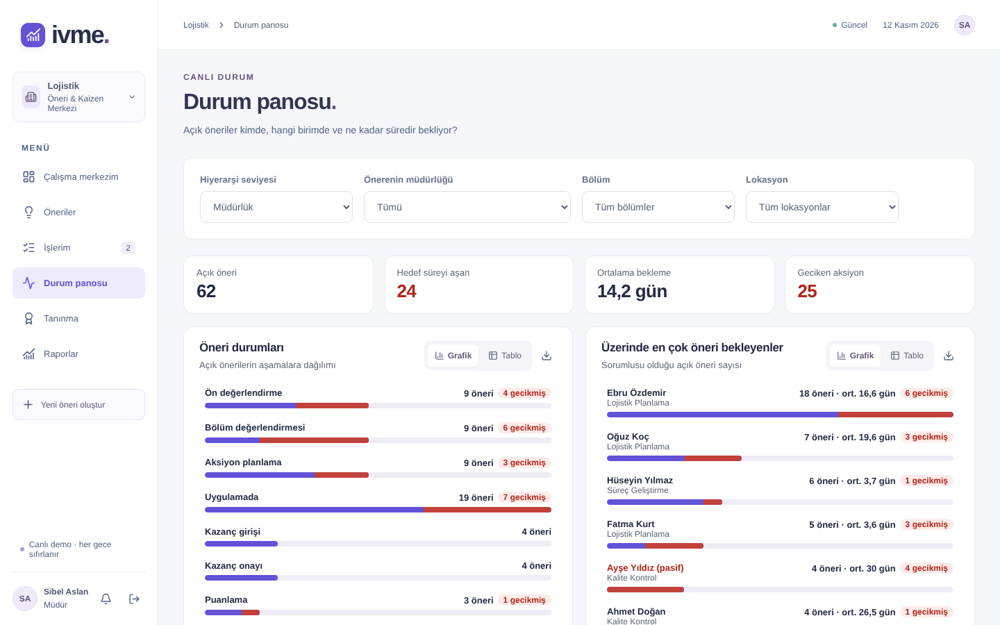
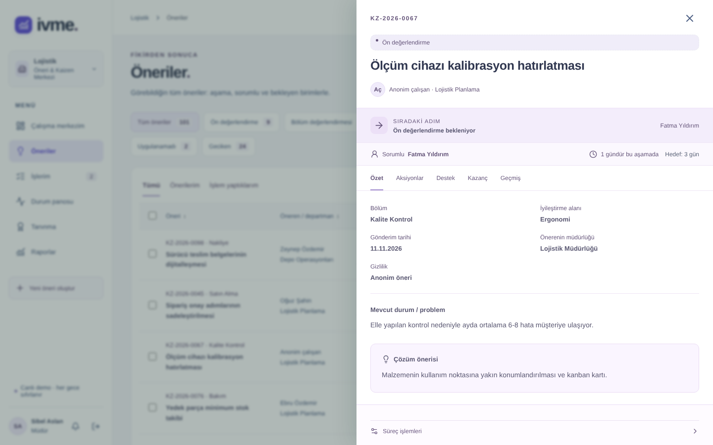
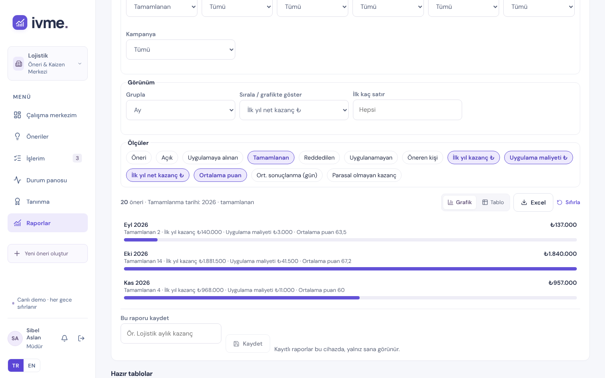
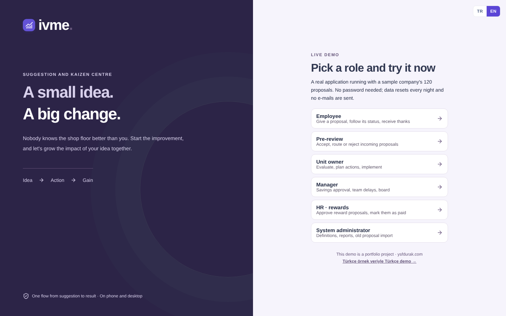
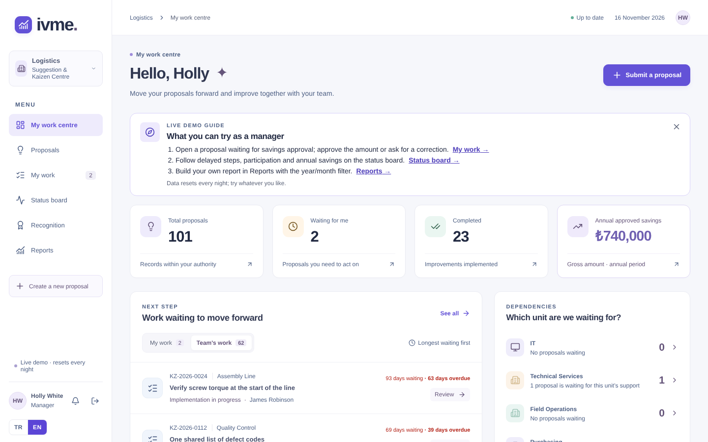
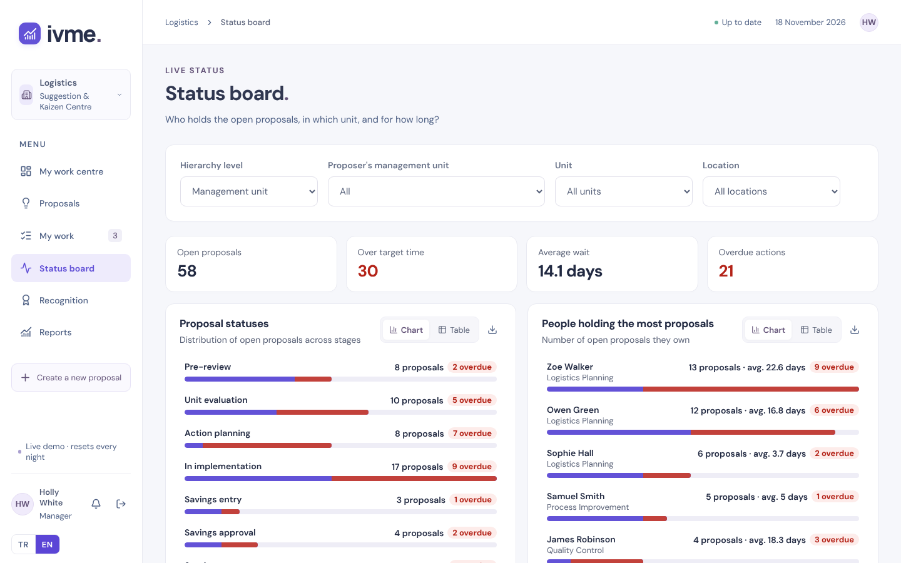
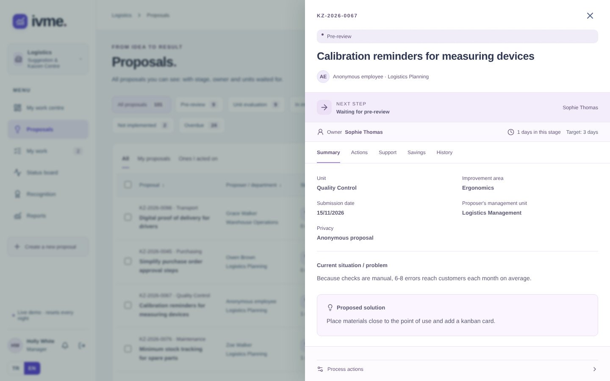
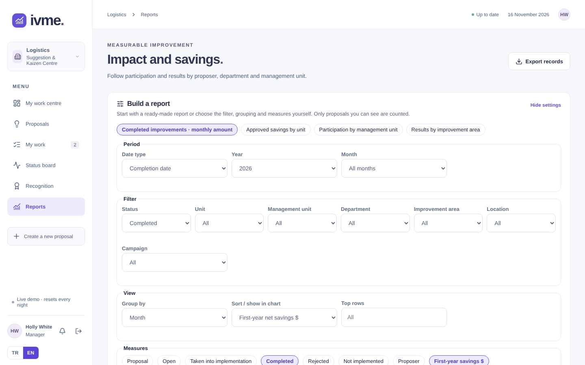

# İvme · Öneri ve Kaizen Merkezi

Çalışanın sahadan verdiği iyileştirme önerisini; değerlendirme, aksiyon, kazanç, puan ve ödüle kadar tek akışta yöneten web uygulaması. Telefondan öneri verilir, masaüstünden yönetilir.

**Canlı demo:** [ivme.ysfdurak.com](https://ivme.ysfdurak.com) (Türkçe) · [ivme-en.ysfdurak.com](https://ivme-en.ysfdurak.com) (English). Bir rol seçerek şifresiz girilir. Her ziyaretçiye örnek bir şirketin 45 önerisiyle sana özel bir alan açılır; başka ziyaretçiler yazdıklarını ve eklediklerini göremez. Kullanıcı tanımları ve aktarım demoda kapalıdır. Veriler her gece silinir, e-posta gönderilmez.



| Çalışma merkezi | Durum panosu |
|---|---|
|  |  |
| **Öneri detayı** | **Rapor oluşturucu** |
|  |  |


**Kurumda kullanacaksan:** Çalışanların kişisel verisi işlenir. KVKK notları, çalışan duyurusu ve (video projelerinde) çekim öncesi onay şablonu: [docs/KVKK_VE_CALISAN_BILGILENDIRME.md](docs/KVKK_VE_CALISAN_BILGILENDIRME.md).


**Projeyi anlatırken:** Mülakatta sorulabilecek 10 soru, kısa cevaplar ve verilen kararlar (sorun → karar → bedel): [docs/MULAKAT.md](docs/MULAKAT.md).

## Ne çözer

Kâğıt formlarda ya da e-posta zincirlerinde yürüyen öneri sistemlerinde öneri kaybolur, kimde beklediği bilinmez, kazanç ölçülmez, öneren geri bildirim alamaz. İvme her öneriyi sahibi belli, hedef süresi olan bir iş olarak izler ve sonucunu ölçer.

## Öne çıkanlar

- **Uçtan uca akış:** ön değerlendirme → bölüm değerlendirmesi → aksiyon planlama → uygulama → kazanç girişi → müdür onayı → puanlama → tamamlandı. Uygulanamayan öneri ayrı bir durumda kapanır, kazanca gitmez.
- **Sorumluluk ve süre:** bölüm bazlı atama tablosu, aşama hedef süreleri, gecikme göstergeleri. Değerlendiricilere gecikmelerini listeleyen günlük tek e-posta gider.
- **Destek beklemesi:** IT ve Teknik İşler gibi birimlerde bekleyen işler talep numarasıyla izlenir.
- **Devir ve geri alma:** işler kişiden kişiye tek tek ya da toplu devredilir. Devir geri alınabilir. Pasif kullanıcının işleri ortada kalmaz.
- **Kazanç ve puan:** parasal ve parasal olmayan kazanç, uygulama maliyeti ve net kazanç tutulur. Puanlama kriterleri ağırlıklı ve kuruma göre tanımlanır.
- **Ödül:** puanlamadan sonra kurallara göre ödül önerisi otomatik oluşur (ör. 0,5 maaş ya da sabit tutar). İK onaylar ve ödendi olarak işaretler. Maaş bilgisi tutulmaz.
- **Raporlar:** durum panosu, katılım istatistikleri (hiç öneri vermeyen, 5 ve üzeri öneri veren, en çok öneri veren ilk N kişi) ve yıl/ay filtreli, istenen ölçüyle rapor oluşturucu.
- **Katılımı artıranlar:** anonim öneri, kampanyalar, önce/sonra fotoğrafı, benzer öneri uyarısı, tanınma ekranı, QR ile doğrudan öneri.
- **Kuruma uyarlama:** öneri sınıfları, ret ve uygulanamama nedenleri, kazanç türleri, puan kriterleri, hedef süreler, bildirim kuralları ve para birimi (varsayılan Türk lirası; avro, dolar, sterlin) Tanımlar ekranından yönetilir.
- **Geçiş:** kullanıcılar ve eski öneriler Excel ile aktarılır. Aktarım önce kontrol edilir; sonradan geri alınabilir.
- **Erişilebilirlik:** klavye ile kullanım ve ekran okuyucu etiketleri. Ekranlar axe ile taranmıştır.
- **Türkçe / English:** arayüz, e-postalar, raporlar ve dışa aktarımlar iki dilde. Kişi dilini TR/EN düğmesiyle seçer; kurulumun varsayılanı `IVME_LANG`. Ayrıntı: [docs/DIL_DESTEGI.md](docs/DIL_DESTEGI.md).

## İki sürüm, ortak çekirdek

| | Süreç sürümü | Yapay zekâ (MCP) sürümü |
|---|---|---|
| Öneri akışı, raporlar, ödül, bildirim | ✔ | ✔ |
| MCP sunucusu (salt okuma, 5 araç, kişisel erişim anahtarı) | — | ✔, Tanımlar'dan açılır, varsayılan kapalı |

Öneri içeriği hiçbir dış yapay zekâ servisine gönderilmez. MCP katmanı yalnız kurumun kendi içindeki yapay zekâsına bağlanmak üzere tasarlandı. Ayrıntı: [docs/MCP_REHBERI.md](docs/MCP_REHBERI.md). Sürüm `IVME_EDITION` ortam değişkeniyle seçilir. `node scripts/paketle.mjs surec` komutu MCP dosyalarını içermeyen paketi üretir.

## Teknik yapı

- **Arayüz:** React, Vinext (Next.js uyumlu, Vite tabanlı), TypeScript
- **Sunucu:** Cloudflare Workers, D1 (SQLite)
- **Süreç kuralları:** `lib/workflow.ts`. Sunucudan ve arayüzden bağımsız, saf bir komut işleyici (`applyCommand`). Bütün yetki ve durum geçişleri burada tanımlı ve test ediliyor.
- **Veri:** kullanıcılar ve oturumlar ayrı tablolarda. Öneri verisi sürümlü tek bir çalışma alanı kaydında tutulur; kayıt bazlı eşzamanlılık denetimi vardır.
- **Bildirim:** önce giden kutusuna yazılır, sonra gönderilir. Microsoft Graph (Outlook) ya da webhook (Power Automate, n8n…) desteklenir.
- **Güvenlik:** PBKDF2 ile saklanan şifreler, yeni hesaplara tek kullanımlık geçici şifre ve yöneticinin şifre sıfırlaması, HttpOnly oturum çerezi, origin denetimi, 5 hatalı girişte geçici kilit, rol bazlı görünürlük, anonim önerenin kimliğinin gizlenmesi.

```
app/            ekranlar ve API uçları (app/api/*/route.ts)
lib/            süreç kuralları, model, raporlar, bildirim, aktarım, MCP
lib/vitrin/     canlı demonun örnek verisi
tests/          birim ve entegrasyon testleri
docs/           geliştirme notları, rehberler, ekran görüntüleri
worker/         Workers giriş noktası (istek + gece sıfırlama görevi)
```

## Yerelde çalıştırma

Node.js 22.13 ve üzeri ile pnpm gerekir.

```sh
pnpm install
npm run build
npm start                                   # http://localhost:8787
npm start -- --var IVME_VITRIN:0            # vitrin yerine normal giriş ekranı
./scripts/test.sh                           # 22 test grubu
```

Büyük test verisi üretmek için `scripts/test-verisi/README.md` dosyasına bakın.

## Yayın

`wrangler.jsonc` Cloudflare Workers ayarlarını içerir. Depo Cloudflare Workers Builds'e bağlıdır; `main` dalına her gönderimde derlenir ve yayınlanır. İngilizce demo aynı depodan ayrı bir Worker (`ivme-en`) olarak derlenir: `CLOUDFLARE_ENV=en npm run build` (kurulum adımları: [docs/DIL_DESTEGI.md](docs/DIL_DESTEGI.md)). Cloudflare panelinde en sağlam yol, `ivme-en` Worker'ının **Settings → Build → Variables and secrets** bölümüne `CLOUDFLARE_ENV = en` derleme değişkenini eklemek ve derleme komutunu `npm run build` bırakmaktır. Derleme günlüğünde `ivme-en-db` ve `IVME_LANG: "en"` görünmüyorsa Worker Türkçe ayarla yayınlanmıştır. D1 veritabanı ilk yayında otomatik oluşturulur, tablolar uygulamanın ilk açılışında kurulur.

**Şirket kurulumu için:**
- `IVME_VITRIN` `0` yapılır.
- E-posta için `EMAIL_PROVIDER` ve ilgili gizli anahtarlar eklenir.
- Kurumun e-posta ve kimlik altyapısı bağlanır.

Bu sürüm bütün çalışma alanını tek bir kayıtta tuttuğu için D1'in 2 MB satır sınırına bağlıdır. Fotoğrafsız yaklaşık 600 öneriye kadar uygundur. Gerçek kullanımda verinin tablolara ayrılması ve kurum sunucusuna (VPS, PostgreSQL) taşınması önerilir.

## Belgeler

- [docs/IYILESTIRME_NOTLARI.md](docs/IYILESTIRME_NOTLARI.md): her özelliğin neden ve nasıl eklendiği, tur tur
- [docs/AKTARIM_REHBERI.md](docs/AKTARIM_REHBERI.md): eski önerilerin Excel ile aktarılması ve geri alınması
- [docs/MCP_REHBERI.md](docs/MCP_REHBERI.md): yapay zekâ katmanı, kurulum ve güvenlik
- [docs/DIL_DESTEGI.md](docs/DIL_DESTEGI.md): Türkçe / English arayüz, yeni metin ekleme, İngilizce demo
- [docs/KABUL_VE_KARAR_NOTLARI.md](docs/KABUL_VE_KARAR_NOTLARI.md): ilk pilotun kararları

## English

İvme is an employee suggestion and kaizen management system. One workflow covers each idea from submission through review, action, savings, scoring and reward, with role-based work queues, stage targets and overdue alerts, a report builder, participation statistics, e-mail notifications, Excel migration and an optional read-only MCP layer for in-house AI. The interface, e-mails, reports and exports are available in Turkish and English (TR/EN switch; installation default via `IVME_LANG`). English live demo with English sample data: [ivme-en.ysfdurak.com](https://ivme-en.ysfdurak.com). Pick a role to sign in; sample data resets nightly.



| My work centre | Status board |
|---|---|
|  |  |
| **Proposal detail** | **Report builder** |
|  |  |

Security: passwords are stored with PBKDF2; new accounts get a one-time temporary password shown once to the administrator, who can also reset a forgotten password.

## Lisans

Bu proje [PolyForm Shield 1.0.0](LICENSE.md) lisansıyla yayınlanır. Kaynak kodu açıktır, ancak resmi anlamda bir "açık kaynak" lisansı değildir.

- **Serbest:** Kişiler, okullar ve şirketler kendi işlerinde ücretsiz kullanabilir, değiştirebilir ve kendi bilgisayarlarına ya da sunucularına kurabilir. İzin almak gerekmez.
- **Yazılı izin gerekir:** Yazılımı satmak, adını değiştirip ürün gibi sunmak ya da bununla (ücretsiz olsa bile) rakip bir ürün veya hizmet sunmak.
- **Garanti yok:** Yazılım olduğu gibi sunulur. Bağlayıcı olan İngilizce lisans metnidir.
- Üçüncü taraf bileşenler kendi lisanslarına tabidir.
- Üçüncü taraf parçaların listesi: [UCUNCU-TARAF.md](UCUNCU-TARAF.md).

**Kurum içinde kurulum:** Yukarıdaki **Yayın** bölümündeki "Şirket kurulumu için" maddelerine bakın. Gerçek kullanımda verinin kurum sunucusuna (VPS, PostgreSQL) taşınması önerilir.

Kurumunuzda kullanıyorsanız haber verirseniz sevinirim: kurulumda yardımcı olabilir, kurumunuza özel ihtiyaçları birlikte değerlendirebiliriz. İletişim: iletisim@ysfdurak.com

### License (English)

Released under [PolyForm Shield 1.0.0](LICENSE.md). The source is available, but this is not an OSI "open source" licence.

- **Free:** individuals, schools and companies may use it in their own work, change it and run it on their own computers or servers. No permission needed.
- **Needs written permission:** selling it, rebranding it as a product, or providing a product or service that competes with it (even free of charge).
- **No warranty:** provided as is. The English licence text is binding.
- Third-party components keep their own licences.
- List of third-party parts: [UCUNCU-TARAF.md](UCUNCU-TARAF.md).

**Installing it in your organisation:** see "Şirket kurulumu için" (company setup) under **Yayın** above. For real use, moving the data to your own server (VPS, PostgreSQL) is recommended.

Using it in your organisation? I'd be glad to hear from you: I can help with setup and look at your organisation's needs together. Contact: contact@ysfdurak.com

